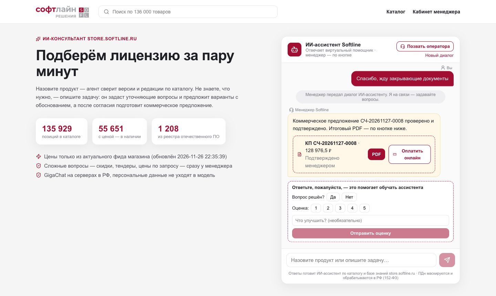

# 1. Что это

ИИ-консультант — это чат на странице магазина store.softline.ru (стенд: https://methodagent.ru). Он работает круглосуточно и помогает:

- подобрать программное обеспечение, если вы пока не знаете, какой продукт нужен;
- уточнить редакцию, версию, срок и количество лицензий, если продукт уже известен;
- узнать цену и наличие: цены берутся из актуального каталога магазина (фид, ~136 000 позиций, обновляется ежедневно);
- получить коммерческое предложение (КП) или счёт в PDF и оплатить его онлайн;
- получить ответ по доставке, оплате, возвратам, документам и активации лицензий;
- в любой момент передать разговор живому менеджеру.

В шапке чата написано «Отвечает виртуальный помощник»: вам отвечает робот, а не человек. Решения, которые робот принять не может (скидка больше 5%, отсрочка платежа, тендер, товар без цены), он передаёт менеджеру.

# 2. Как начать

{width=100%}

1. Откройте https://methodagent.ru. Окно ассистента находится справа.
2. Напишите вопрос своими словами или нажмите одну из подсказок под приветствием.
3. Можно воспользоваться строкой «Поиск по 136 000 товаров» в шапке. При вводе появляются подходящие продукты с ценой «от». Клик по продукту открывает его карточку в магазине, а Enter или кнопка «Спросить ИИ-ассистента» отправляет запрос в чат.

# 3. Если вы знаете, что нужно

Пример: «Нужен Kaspersky Endpoint Security для бизнеса Расширенный на 50 ПК на год». Можно вставить и точное название позиции с сайта.

Ассистент:

1. найдёт продукт в каталоге и сверит редакцию и версию;
2. если вариантов несколько (новая лицензия или продление, 1 год или 2, коммерческая или для образования), задаст один уточняющий вопрос;
3. назовёт цену выбранного варианта и итог. Под ответом появятся карточки товаров со ссылкой на магазин.

Каждая цена в ответе сверяется с каталогом. Если у товара нет цены, ассистент не называет её, а передаёт запрос менеджеру.

# 4. Если вы не знаете, что нужно

Пример: «Нужна защита для небольшого офиса, у нас 15 компьютеров и почтовый сервер».

Сначала ассистент выяснит требования: сколько устройств и пользователей, какие ОС, нужен ли российский продукт из реестра, какой бюджет. Затем предложит 1–3 варианта, объяснит различия и назовёт цены.

# 5. Коммерческое предложение и счёт

1. Попросите: «Сформируйте КП» или «Выставьте счёт».
2. В чате появится карточка документа с позициями и суммой. Скидку до 5% ассистент может дать сам, большую согласует менеджер.
3. Для счёта на организацию заполните в карточке реквизиты: название, ИНН, КПП, e-mail. **Не пишите реквизиты и личные данные в текст сообщения** — для них есть форма.
4. Кнопка «PDF» скачивает документ по образцу ПАО «Софтлайн». НДС — 22%, ПО из реестра российского ПО продаётся без НДС.
5. Кнопка «Оплатить онлайн» открывает оплату через ЮKassa. На стенде включён демонстрационный режим, деньги не списываются.

# 6. Позвать оператора

Нажмите кнопку **«Позвать оператора»** над полем ввода или напишите «позовите менеджера». В чате появится сообщение о передаче. Менеджер видит весь разговор — в кабинете или в Telegram — и отвечает в этом же окне. Пока он пишет, вы увидите «Менеджер печатает…», а в шапке — «Диалог ведёт менеджер Softline».

Ассистент сам передаёт разговор менеджеру, если не уверен в ответе, а также при вопросах о тендере, отсрочке платежа, скидке больше 5% или товаре без цены.

# 7. Оценка ответов и опрос

- Под каждым ответом есть 👍 и 👎. Отметка 👎 с комментарием попадает к менеджеру: он исправит ответ и добавит его в базу знаний.
- В конце разговора появится короткий опрос «Ответьте, пожалуйста, чтобы обучить решение»: решён ли вопрос, оценка от 1 до 5 и комментарий. Удачные ответы становятся примерами, на которых учится ассистент.

# 8. Персональные данные

- Телефоны, e-mail, ИНН, номера карт и паспортов в тексте сообщений маскируются до отправки в языковую модель.
- Модель (GigaChat) работает на серверах в России, данные за рубеж не передаются.
- Реквизиты для счёта вводятся в отдельную форму и хранятся только в базе магазина.

# 9. Частые вопросы

| Вопрос | Ответ |
|---|---|
| Это живой человек? | Нет, ИИ-ассистент. Чтобы поговорить с человеком, нажмите «Позвать оператора». |
| Цены актуальные? | Да. Каталог ежедневно обновляется из фида магазина, и каждая цена в ответе сверяется с ним. |
| Можно ли постоплату? | Стандартно — 100% предоплата. Отсрочку согласует менеджер. |
| Где лицензии после оплаты? | Ассистент ответит по базе знаний: сроки, доставка ключей, активация. |
| Ассистент ошибся | Нажмите 👎 и напишите, что не так. Менеджер исправит ответ. |
