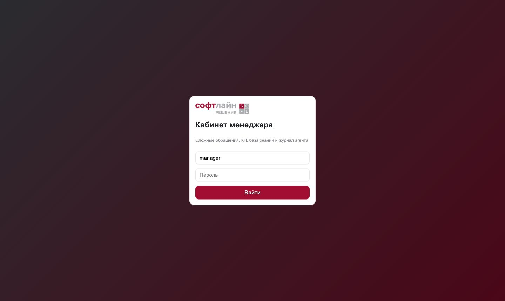
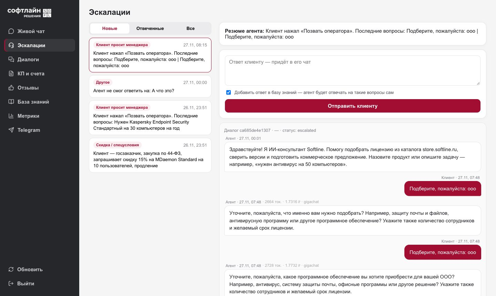
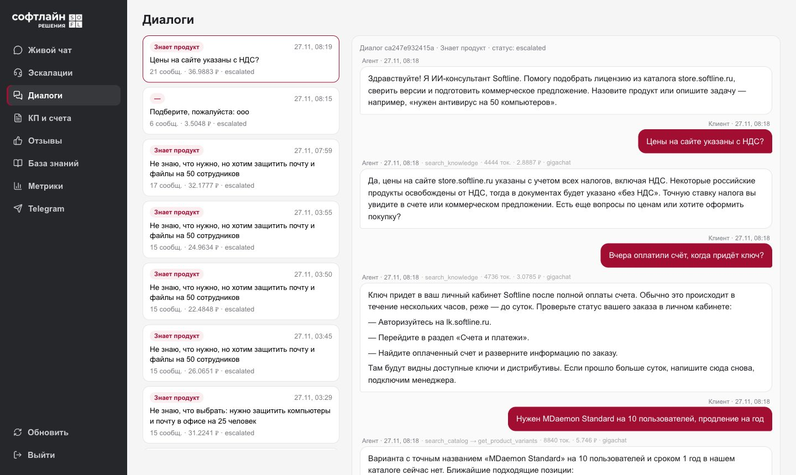
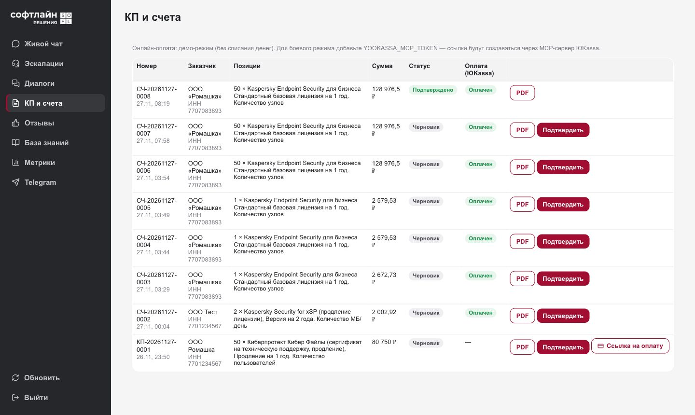

# 1. Вход

{width=100%}

- Адрес: https://methodagent.ru/manager
- Учётные записи: `manager` — менеджер, `jury` — просмотр для жюри. Пароли выдаёт администратор, в публичном репозитории их нет.
- После 5 неудачных попыток подряд вход блокируется на минуту.
- Сессия действует 72 часа. Кнопка «Выход» находится в меню.

Кабинет держит постоянное соединение с сервером (WebSocket): новые сообщения, эскалации и индикатор «печатает…» приходят сразу, без обновления страницы.

# 2. Разделы

| Раздел | Для чего |
|---|---|
| Живой чат | Активные диалоги в реальном времени: читать, брать диалог на себя, отвечать |
| Эскалации | Обращения, которые ассистент передал человеку, с причиной и резюме |
| Диалоги | История разговоров с вызовами инструментов и модели |
| КП и счета | Документы ассистента: подтверждение, PDF, ссылка на оплату |
| Отзывы | Ответы с 👎: исправление и пополнение базы знаний |
| База знаний | Статьи, по которым отвечает ассистент; добавление новых |
| Метрики | Диалоги, эскалации по причинам, CSAT, доля решённых, токены и стоимость |
| Telegram | Подключение бота @SoftlineSupportBot: эскалации и ответы клиенту прямо из Telegram |
| Справка | Это руководство в кабинете: работа с разделами по шагам, подключение Telegram, скриншоты, частые вопросы |

# 3. Живой чат

{width=100%}

1. Слева — список диалогов. У диалога с новыми сообщениями появляется счётчик непрочитанных.
2. Откройте диалог, чтобы увидеть всю переписку клиента с ассистентом. Пока клиент пишет, отображается «Клиент печатает…».
3. Нажмите **«Взять диалог»**: ассистент перестаёт отвечать, а клиент видит сообщение «К диалогу подключился …».
4. Напишите ответ внизу. Для типовых фраз есть быстрые ответы: приветствие, «Подготовлю КП…», уточнение количества пользователей, запрос ТЗ для госзакупки, прощание. Клиент получает сообщение сразу.
5. Когда вопрос решён, нажмите **«Вернуть агенту»**: дальше снова отвечает ассистент.

# 4. Эскалации

{width=100%}

Ассистент передаёт обращение человеку в следующих случаях:

| Причина | Когда |
|---|---|
| Клиент просит менеджера | Нажата кнопка «Позвать оператора» или есть явная просьба |
| Цена по запросу | У товара в каталоге нет цены |
| Скидка / спецусловия | Скидка больше 5%, отсрочка платежа |
| Госзакупки / тендер | 44-ФЗ, 223-ФЗ, конкурс |
| Сложная конфигурация | Нестандартная поставка, много позиций |
| Продукт не найден | Товара нет в каталоге |
| Вопрос по заказу | Статус конкретного заказа |
| Другое | Ассистент не уверен в ответе |

У каждой эскалации есть причина, резюме от ассистента и вся переписка. Ответ, введённый в поле, сразу уходит клиенту в чат. С отметкой **«Добавить ответ в базу знаний»** он станет новой статьёй, и в следующий раз ассистент ответит на такой вопрос сам.

# 4а. Диалоги, база знаний и метрики

{width=100%}

- **Диалоги** — журнал всех разговоров: сообщения, вызовы инструментов агента, вызовы модели (токены, стоимость, время), КП. Персональные данные в журнале модели показаны метками.
- **База знаний** — статьи, по которым агент отвечает на вопросы о покупке и после неё; форма «Добавить статью». Цены в статьи не пишите — агент берёт их из каталога.
- **Метрики** — диалоги, доля решённых без менеджера, эскалации по причинам, CSAT, стоимость ответа, состояние каталога.

{width=100%}

# 5. КП и счета

{width=100%}

1. В таблице перечислены документы: номер, тип (КП или счёт), клиент, сумма, скидка, статус, оплата.
2. «PDF» открывает документ.
3. «Подтвердить» — менеджер проверил документ.
4. **«Ссылка на оплату»** создаёт платёж ЮKassa по документу и отправляет ссылку клиенту в чат. Статус оплаты обновляется в таблице.

## Оплата через ЮKassa (MCP)

Платежи создаются через официальный MCP-сервер ЮKassa (`https://mcp.yookassa.ru`, инструменты `create_payment` и `get_payment`). На стенде нет боевого магазина ЮKassa, поэтому включён **демо-режим**: цепочка та же, но страница оплаты демонстрационная и деньги не списываются. Текущий режим указан над таблицей. Реальные платежи включает администратор, добавив токен магазина.

# 6. Отзывы и обучение ассистента

{width=100%}

- В разделе «Отзывы» собраны ответы с 👎 и комментариями клиентов.
- Впишите правильный ответ и нажмите **«Исправить и добавить в базу знаний»**. Ассистент начнёт отвечать по новой статье сразу, без перезапуска.
- Ответы с 👍 автоматически становятся примерами удачных ответов (показатель «Примеров для агента» в «Метриках»). Похожие примеры ассистент подмешивает в подсказку при новых вопросах.
- CSAT, доля решённых вопросов и комментарии из итогового опроса видны в «Метриках».

# 7. Telegram-бот @SoftlineSupportBot

{width=100%}

Бот нужен, чтобы не держать кабинет открытым: новые обращения приходят в Telegram, а ответить клиенту можно прямо оттуда.

1. Откройте раздел «Telegram» и нажмите «Подключить Telegram». Откроется бот с одноразовым кодом, он действует 30 минут. Нажмите «Запустить». Бот ответит «Telegram подключён», а чат появится в списке подключённых.
2. При каждой новой эскалации бот присылает её причину, резюме агента и последние сообщения клиента. Под сообщением есть кнопки:
   - **«Взять диалог»** — агент замолкает, диалог ведёте вы;
   - **«Вернуть агенту»** — диалог снова ведёт ИИ-ассистент;
   - **«Открыть кабинет»**.
3. Чтобы ответить клиенту, ответьте реплаем на уведомление. Текст сразу придёт клиенту в чат на сайте от имени «Менеджер Softline (Telegram)». Бот подтвердит отправку: «Отправлено клиенту».
4. Пока диалог ведёт менеджер, новые сообщения клиента тоже приходят в Telegram.
5. Подключать бота можно с нескольких аккаунтов, каждый получает уведомления. Кнопка «Отключить» отвязывает чат.

Персональные данные клиентов в Telegram скрыты: телефоны, e-mail и ИНН заменены метками вида [ТЕЛ_1]. Telegram — зарубежный сервис, поэтому туда уходит только обезличенный текст (152-ФЗ). Полный текст — в кабинете. Посторонний, написавший боту без кода из кабинета, ничего не получит.

# 8. Правила

- Скидку до 5% ассистент даёт сам. Большая скидка — только решение менеджера.
- Не просите присылать паспортные и банковские данные в чат: для реквизитов в карточке счёта есть форма.
- Взяв диалог, не забудьте вернуть его агенту, иначе клиент будет ждать ответа человека.
- Целевое время ответа на эскалацию в рабочее время — до 10 минут. Ассистент тем временем уже дал клиенту первичный ответ.
