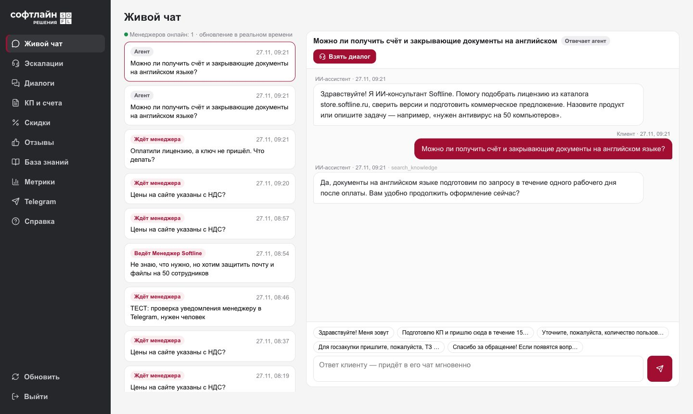
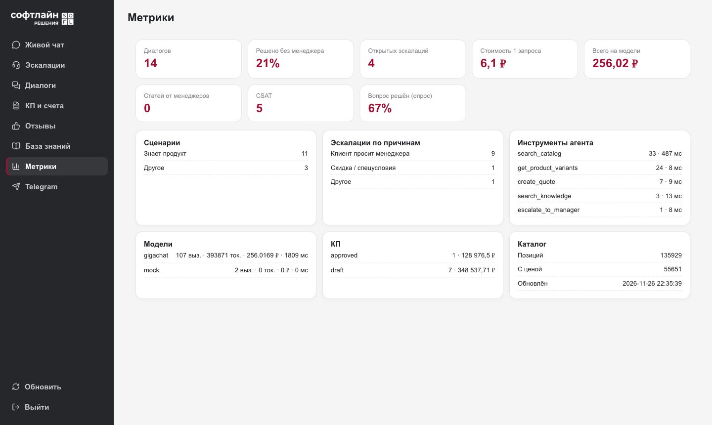
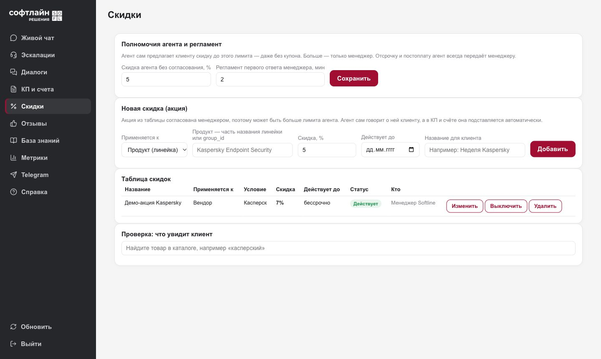
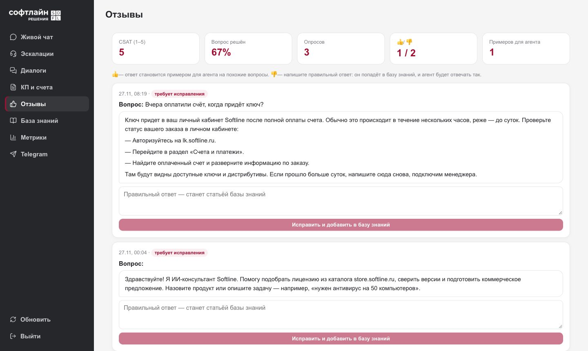
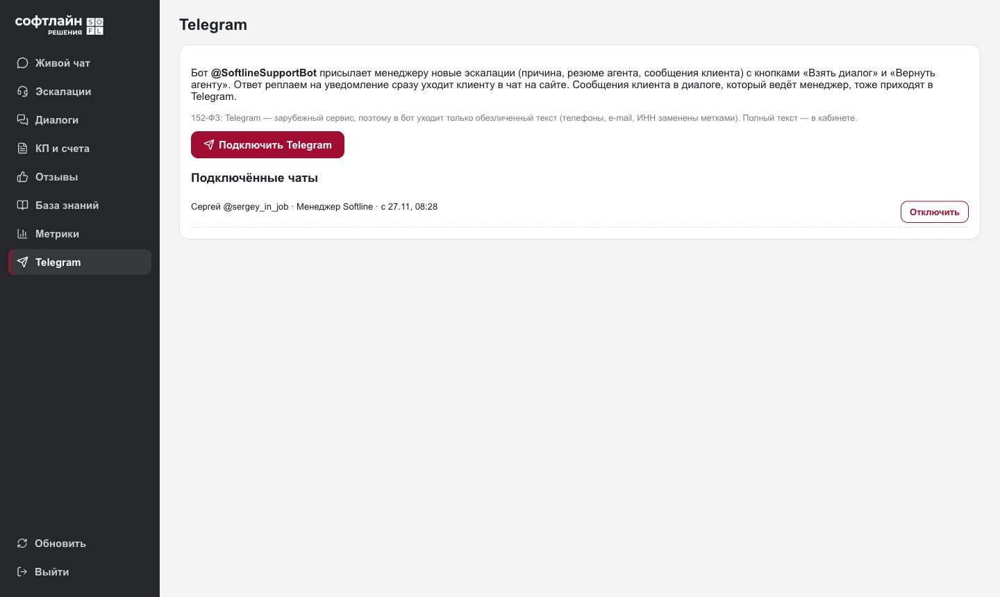

# 1. Вход

{width=100%}

- Адрес: https://methodagent.ru/manager
- Учётные записи: `manager` — менеджер, `jury` — просмотр для жюри. Пароли выдаёт администратор, в публичном репозитории их нет.
- После 5 неудачных попыток подряд вход блокируется на минуту.
- Сессия действует 72 часа. Кнопка «Выход» находится в меню.

Кабинет держит постоянное соединение с сервером (WebSocket): новые сообщения, эскалации и индикатор «печатает…» приходят сразу, без обновления страницы.

# 2. Разделы

| Раздел | Для чего |
|---|---|
| Живой чат | Активные диалоги в реальном времени: читать, брать диалог на себя, отвечать |
| Эскалации | Обращения, которые ассистент передал человеку, с причиной и резюме |
| Диалоги | История разговоров с вызовами инструментов и модели |
| КП и счета | Документы ассистента: подтверждение, PDF, ссылка на оплату |
| Отзывы | Ответы с 👎: исправление и пополнение базы знаний |
| База знаний | Статьи, по которым отвечает ассистент; добавление новых |
| Метрики | Диалоги, эскалации по причинам, CSAT, доля решённых, токены и стоимость |
| Telegram | Подключение бота @SoftlineSupportBot: эскалации и ответы клиенту прямо из Telegram |
| Скидки | Лимит скидки агента, регламент ответа, таблица акций, которые агент сам предлагает клиентам |
| Справка | Это руководство в кабинете: карта кабинета, работа с разделами по шагам, подключение Telegram, скриншоты, частые вопросы |

# 3. Живой чат

{width=100%}

1. Слева — список диалогов. У диалога с новыми сообщениями появляется счётчик непрочитанных.
2. Откройте диалог, чтобы увидеть всю переписку клиента с ассистентом. Пока клиент пишет, отображается «Клиент печатает…».
3. Нажмите **«Взять диалог»**: ассистент перестаёт отвечать, а клиент видит сообщение «К диалогу подключился …».
4. Напишите ответ внизу. Для типовых фраз есть быстрые ответы: приветствие, «Подготовлю КП…», уточнение количества пользователей, запрос ТЗ для госзакупки, прощание. Клиент получает сообщение сразу.
5. Когда вопрос решён, нажмите **«Вернуть агенту»**: дальше снова отвечает ассистент.

# 4. Эскалации

{width=100%}

Ассистент передаёт обращение человеку в следующих случаях:

| Причина | Когда |
|---|---|
| Клиент просит менеджера | Нажата кнопка «Позвать оператора» или есть явная просьба |
| Цена по запросу | У товара в каталоге нет цены |
| Скидка / спецусловия | Скидка больше 5%, отсрочка платежа |
| Госзакупки / тендер | 44-ФЗ, 223-ФЗ, конкурс |
| Сложная конфигурация | Нестандартная поставка, много позиций |
| Продукт не найден | Товара нет в каталоге |
| Вопрос по заказу | Статус конкретного заказа |
| Другое | Ассистент не уверен в ответе |

У каждой эскалации есть причина, резюме от ассистента и вся переписка. Ответ, введённый в поле, сразу уходит клиенту в чат. С отметкой **«Добавить ответ в базу знаний»** он станет новой статьёй, и в следующий раз ассистент ответит на такой вопрос сам.

# 4а. Диалоги, база знаний и метрики

{width=100%}

- **Диалоги** — журнал всех разговоров: сообщения, вызовы инструментов агента, вызовы модели (токены, стоимость, время), КП. Персональные данные в журнале модели показаны метками.
- **База знаний** — статьи, по которым агент отвечает на вопросы о покупке и после неё; форма «Добавить статью». Цены в статьи не пишите — агент берёт их из каталога.
- **Метрики** — диалоги, доля решённых без менеджера, эскалации по причинам, CSAT, стоимость ответа, состояние каталога.

{width=100%}

# 4б. Скидки и регламент ответа

{width=100%}

Раздел «Скидки» состоит из трёх блоков.

**Полномочия агента и регламент.**

- «Скидка агента без согласования, %» — по умолчанию 5%, максимум 15%. В этих пределах агент сам предлагает скидку, даже если у клиента нет купона: например, когда клиент сомневается из-за цены, сравнивает с другим магазином или берёт много лицензий. Скидка больше лимита — только решение менеджера.
- «Регламент первого ответа менеджера, мин» — по умолчанию 2 минуты (сейчас клиент ждёт первого ответа человека примерно столько же).
- Кнопка «Сохранить» применяет оба значения.

**Новая скидка (акция).** Акцию согласовал менеджер, поэтому её процент может быть больше лимита агента.

1. «Применяется к»: все товары, вендор, продукт (часть названия линейки или group_id), категория или артикулы через запятую.
2. Заполните поле условия, процент скидки (до 50%), срок действия (если пусто — бессрочно) и название для клиента.
3. Нажмите «Добавить».

С этого момента агент сам говорит клиенту об акции и называет цену со скидкой, а в КП и счёте скидка подставляется автоматически. Если подходят и акция, и скидка агента, применяется бо́льшая.

**Таблица скидок.** Кнопки «Изменить», «Выключить» и «Удалить» в строке правила. Блок «Проверка: что увидит клиент» показывает, какие товары каталога попадают под акцию.

**Отсрочка и постоплата.** Их решает только менеджер: агент сразу передаёт такое обращение с причиной «Скидка / спецусловия».

**Регламент ответа.**

- Раньше клиент ждал первого ответа около 2 минут, теперь агент отвечает за секунды.
- У новой эскалации виден таймер «ждёт N с/мин»: зелёный — в пределах регламента, красный — просрочено.
- О просроченной эскалации бот присылает напоминание в Telegram.
- В «Метриках» есть блок «Регламент ответа»: медиана первого ответа клиенту, медиана ответа менеджера на эскалацию, доля ответов в регламенте и число просроченных эскалаций.

# 4в. Цикл обучения: менеджер ответил — агент запомнил

1. Клиент спрашивает о том, чего нет в базе знаний, например «Можно ли получить счёт на английском языке?». Агент честно говорит, что не знает, и передаёт обращение — или клиент сам нажимает «Позвать оператора».
2. Менеджер отвечает в «Эскалациях» с галочкой «Добавить ответ в базу знаний».
3. Ответ сразу становится статьёй базы знаний. Проверка старшего не нужна, срока годности у статьи нет (так решил заказчик). Статью можно изменить или удалить в «Базе знаний».
4. Следующий клиент с тем же вопросом получает ответ от агента сразу, без менеджера.

Этот цикл проверен в регрессе в браузере, и жюри может пройти его само.

# 5. КП и счета

{width=100%}

1. В таблице перечислены документы: номер, тип (КП или счёт), клиент, сумма, скидка, статус («Выдан клиенту», «Подтверждено»), оплата. Отметка «Проверить поставку» значит, что у позиции есть цена, но в фиде она помечена «нет в наличии»: документ уже выдан клиенту, а менеджеру нужно подтвердить фактическую поставку.
2. «PDF» открывает документ.
3. Документ выдаётся клиенту сразу, проверка менеджером не обязательна (так решил заказчик). «Подтвердить» — по желанию; такой диалог всё равно считается закрытым агентом.
4. **«Ссылка на оплату»** создаёт платёж ЮKassa по документу и отправляет ссылку клиенту в чат. Статус оплаты обновляется в таблице.

## Оплата через ЮKassa (MCP)

Платежи создаются через официальный MCP-сервер ЮKassa (`https://mcp.yookassa.ru`, инструменты `create_payment` и `get_payment`). На стенде нет боевого магазина ЮKassa, поэтому включён **демо-режим**: цепочка та же, но страница оплаты демонстрационная и деньги не списываются. Текущий режим указан над таблицей. Реальные платежи включает администратор, добавив токен магазина.

# 6. Отзывы и обучение ассистента

{width=100%}

- В разделе «Отзывы» собраны ответы с 👎 и комментариями клиентов.
- Впишите правильный ответ и нажмите **«Исправить и добавить в базу знаний»**. Ассистент начнёт отвечать по новой статье сразу, без перезапуска.
- Ответы с 👍 автоматически становятся примерами удачных ответов (показатель «Примеров для агента» в «Метриках»). Похожие примеры ассистент подмешивает в подсказку при новых вопросах.
- CSAT, доля решённых вопросов и комментарии из итогового опроса видны в «Метриках».

# 7. Telegram-бот @SoftlineSupportBot

{width=100%}

Бот нужен, чтобы не держать кабинет открытым: новые обращения приходят в Telegram, а ответить клиенту можно прямо оттуда.

1. Откройте раздел «Telegram» и нажмите «Подключить Telegram». Откроется бот с одноразовым кодом, он действует 30 минут. Нажмите «Запустить». Бот ответит «Telegram подключён», а чат появится в списке подключённых.
2. При каждой новой эскалации бот присылает её причину, резюме агента и последние сообщения клиента. Под сообщением есть кнопки:
   - **«Взять диалог»** — агент замолкает, диалог ведёте вы;
   - **«Вернуть агенту»** — диалог снова ведёт ИИ-ассистент;
   - **«Открыть кабинет»**.
3. Чтобы ответить клиенту, ответьте реплаем на уведомление. Текст сразу придёт клиенту в чат на сайте от имени «Менеджер Softline (Telegram)». Бот подтвердит отправку: «Отправлено клиенту».
4. Пока диалог ведёт менеджер, новые сообщения клиента тоже приходят в Telegram.
5. Подключать бота можно с нескольких аккаунтов, каждый получает уведомления. Кнопка «Отключить» отвязывает чат.

Персональные данные клиентов в Telegram скрыты: телефоны, e-mail и ИНН заменены метками вида [ТЕЛ_1]. Telegram — зарубежный сервис, поэтому туда уходит только обезличенный текст (152-ФЗ). Полный текст — в кабинете. Посторонний, написавший боту без кода из кабинета, ничего не получит.

# 8. Правила

- Скидку до 5% ассистент даёт сам, даже без купона; акции из таблицы «Скидки» он предлагает сам. Большая скидка, отсрочка и постоплата — только решение менеджера.
- Не просите присылать паспортные и банковские данные в чат: для реквизитов в карточке счёта есть форма.
- Взяв диалог, не забудьте вернуть его агенту, иначе клиент будет ждать ответа человека.
- Регламент первого ответа на эскалацию — 2 минуты (настраивается в разделе «Скидки»). Ассистент тем временем уже дал клиенту первичный ответ.
