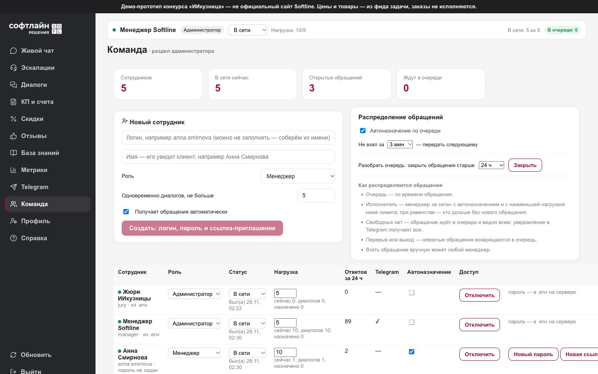
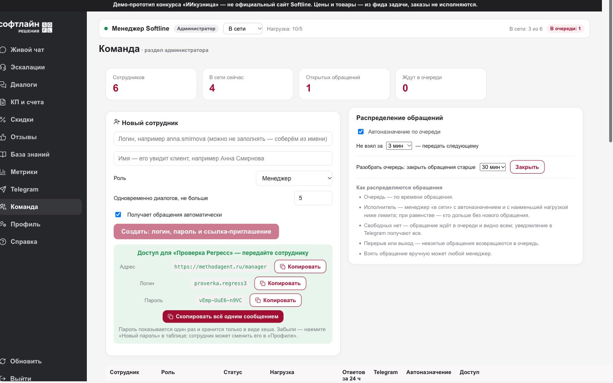
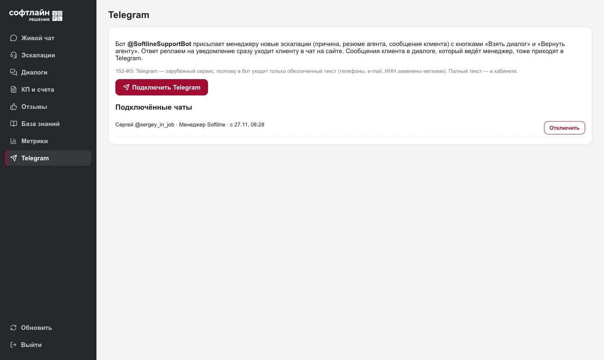

**Ссылки:** сайт с ИИ-ассистентом — https://methodagent.ru · кабинет менеджера — https://methodagent.ru/manager · Telegram-бот менеджера — [@SoftlineSupportBot](https://t.me/SoftlineSupportBot) · материалы — https://methodagent.ru/materials/

| Сайт methodagent.ru | Telegram-бот @SoftlineSupportBot |
|:---:|:---:|
| {width=4cm} | {width=4cm} |


# 1. Состав системы

| Компонент | Технология | Назначение |
|---|---|---|
| app | Python 3.12, FastAPI, Uvicorn | API, агент, WebSocket, раздача фронтенда |
| Фронтенд | React 19, Vite, TypeScript | Витрина с чатом и кабинет менеджера |
| catalog.db | SQLite FTS5 (BM25) | Индекс каталога из фида Mindbox (~136 тыс. позиций) — источник RAG по товарам |
| app.db | SQLite (WAL) | Диалоги, эскалации, КП, отзывы, база знаний, журналы, скидки (`discounts`), настройки (`settings`: лимит скидки агента, регламент ответа, распределение), команда (`users`, `conv_managers`, `team_log`), Telegram |
| LLM | GigaChat 2 Max (основная), YandexGPT Pro 5.1 (резерв) | Ответы и вызовы инструментов |
| PDF | WeasyPrint | КП и счета по шаблону ПАО «Софтлайн» |
| Оплата | ЮKassa MCP (`https://mcp.yookassa.ru`) | Создание и проверка платежей |
| caddy | Caddy 2 | HTTPS (Let's Encrypt), обратный прокси, WebSocket |

Сервер стенда: 4 vCPU, 8 ГБ RAM, 80 ГБ NVMe (Timeweb Cloud MSK). Минимум для пилота — 2 vCPU и 4 ГБ RAM; Ubuntu 22.04 или новее, Docker и Docker Compose. Контейнеру приложения выделено до 4 ГБ (`mem_limit` в `docker-compose.yml`).

# 1а. Команда: администратор и менеджеры

{width=100%}

Обращения Softline ведут много менеджеров. Администратор управляет ими в кабинете, раздел **«Команда»** (виден только роли «Администратор»).

**Роли.**

| Роль | Права |
|---|---|
| Администратор | Всё, что менеджер, плюс: создание и отключение сотрудников, роли, лимиты нагрузки, статусы, правила распределения, разбор очереди, журнал команды, все Telegram-чаты, лимит скидки агента и регламент ответа |
| Менеджер | Диалоги, эскалации, КП и счета, скидки-акции, база знаний, отзывы, метрики, свой Telegram, свой профиль |

**Добавить сотрудника.**

1. «Команда» → блок «Новый сотрудник»: логин (латиница), имя (его видит клиент), роль, «Одновременно диалогов, не больше» (по умолчанию 5), «Получает обращения автоматически».
2. Нажмите «Создать: логин, пароль и ссылка-приглашение». Логин можно не заполнять — он соберётся из имени латиницей (кириллица переводится, у тёзок добавляется цифра); пустой или слишком большой лимит диалогов приводится к 1–30.
3. Появится блок «Доступ для …»: адрес кабинета, логин, пароль и одноразовая ссылка `…/manager?invite=…` (72 часа). У каждой строки — «Копировать», внизу — «Скопировать всё одним сообщением». Отправьте сотруднику любым рабочим каналом.
4. Пароль показывается один раз: в базе хранится только хеш PBKDF2. Забыли или нужно передать доступ заново — «Новый пароль» в строке сотрудника (старый пароль сразу перестаёт работать); «Новая ссылка» — новое приглашение. Сотрудник может сменить пароль в «Профиле».
5. Учётки из `.env` (`MANAGER_LOGIN`, `JURY_LOGIN`) из кабинета не меняются: их пароли — в `.env` на сервере.

{width=100%}

**Таблица сотрудников:** статус (точка «в сети»), роль, статус смены, лимит и текущая нагрузка (диалогов ведёт / назначено обращений), ответов за 24 часа, подключён ли Telegram, автоназначение, «Отключить / Включить». Отключённый сотрудник теряет доступ сразу, его невзятые обращения возвращаются в очередь. Учётки из `.env` отключить или понизить нельзя.

**Распределение обращений** (блок «Распределение обращений»):

1. Очередь — открытые эскалации без исполнителя, по времени создания.
2. Исполнитель — сотрудник со статусом «В сети», с включённым автоназначением и нагрузкой ниже лимита; из них — с наименьшей нагрузкой, при равенстве — кто дольше без нового обращения (по кругу).
3. «Не взял за N мин — передать следующему» (по умолчанию 3 мин) — переназначение, счётчик переназначений виден у обращения.
4. Перерыв, «Не в сети», выход из кабинета, 15 минут без сигнала кабинета (если не подключён Telegram), отключение — невзятые обращения возвращаются в очередь.
5. Свободных нет — обращение ждёт; уведомление в Telegram получают все.
6. Флажок «Автоназначение по очереди» выключает распределение: тогда обращения берут вручную из «Очереди».
7. «Разобрать очередь: закрыть обращения старше N» — закрывает устаревшие обращения (клиент давно ушёл). Данные сохраняются, статус `closed`.

Распределение работает в фоне раз в 3 с и сразу после каждой эскалации. Сколько менеджеров нужно под нагрузку — лист «Нагрузка» в `docs/cost.xlsx` (например, при 500 диалогах в день — около 3 человек на эскалации).

**Журнал команды** — кто кому что назначил, взял, передал, позвал, закрыл; хранится в `team_log`.

**API** (для интеграции с HR-системой или SSO): `GET/POST /api/admin/users`, `PATCH /api/admin/users/{login}`, `POST /api/admin/users/{login}/invite`, `POST /api/admin/users/{login}/password` (новый пароль, показывается один раз), `POST /api/admin/routing`, `POST /api/admin/escalations/close-stale`, `GET /api/admin/log`; для всех сотрудников — `GET /api/manager/team`, `POST /api/manager/presence`, `POST /api/manager/conversations/{id}/transfer|invite|leave`, `POST /api/manager/escalations/{id}/claim|close`.

# 2. Установка

```bash
git clone https://github.com/Fighter90/support_agent.git /opt/support_agent
cd /opt/support_agent
cp .env.example .env        # заполните ключи и пароли (раздел 3)
docker compose up -d --build
docker compose logs -f app  # первый запуск загружает фид каталога (~1 мин)
```

A-запись домена должна указывать на сервер, сертификат Caddy выпустит сам. Домен задаётся в `deploy/Caddyfile` и в `PUBLIC_URL`.

# 3. Настройки (.env)

| Переменная | Назначение |
|---|---|
| `PUBLIC_URL` | Внешний адрес стенда (ссылки на оплату и PDF) |
| `LLM_PROVIDER` | `gigachat` (по умолчанию) или `yandex` |
| `GIGACHAT_AUTH_KEY` | Authorization key из личного кабинета developers.sber.ru |
| `GIGACHAT_SCOPE` | `GIGACHAT_API_PERS` (физлицо), `GIGACHAT_API_B2B` или `GIGACHAT_API_CORP` |
| `GIGACHAT_MODEL` | `GigaChat-2-Max` |
| `LLM_FALLBACK_PROVIDER` | Резервная модель (`yandex`) или пусто |
| `YANDEX_API_KEY`, `YANDEX_FOLDER_ID` | Ключ сервисного аккаунта (роль `ai.languageModels.user`) и каталог |
| `SECRET_KEY` | Секрет подписи токенов входа (длинная случайная строка) |
| `MANAGER_LOGIN`, `MANAGER_PASSWORD` | Первый администратор (руководитель поддержки). Создаётся при старте; пароль из `.env` — источник истины |
| `JURY_LOGIN`, `JURY_PASSWORD` | Учётка администратора для жюри |
| `YOOKASSA_MCP_TOKEN` | Токен магазина ЮKassa для MCP. Если пусто, оплата работает в демо-режиме |
| `YOOKASSA_GATEWAY_ID` | Необязательно: субаккаунт ЮKassa |
| `TELEGRAM_BOT_TOKEN` | Токен бота менеджера от @BotFather. Если пусто, бот выключен |
| `TELEGRAM_PROXY` | Необязательно: прокси для Bot API (`http://…` или `socks5://…`), если api.telegram.org недоступен из сети сервера |
| `TELEGRAM_API_BASE` | Необязательно: свой адрес Bot API, например обратный прокси за рубежом (по умолчанию `https://api.telegram.org`) |
| `LLM_ALLOW_MOCK` | В продакшене `false` (без заглушки модели) |
| `OPENWEIGHTS_BASE_URL` | Модель с открытыми весами: адрес OpenAI-совместимого сервера (`http://vllm.internal:8000/v1`, `http://localhost:11434/v1` для Ollama, `https://llm.api.cloud.yandex.net/v1` для Qwen3 в Yandex AI Studio). Пусто — выключено |
| `OPENWEIGHTS_MODEL`, `OPENWEIGHTS_API_KEY`, `OPENWEIGHTS_AUTH`, `OPENWEIGHTS_PROJECT` | Имя модели (`Qwen/Qwen3.6-35B-A3B`, `qwen3:8b`, `gpt://<каталог>/qwen3.6-35b-a3b/latest`), ключ (пусто для своего сервера), схема `Bearer` или `Api-Key`, каталог Yandex Cloud |
| `OPENWEIGHTS_NO_THINK`, `OPENWEIGHTS_PRICE_PER_1K`, `OPENWEIGHTS_PRICE_OUT_PER_1K` | `true` — выключить режим рассуждения Qwen3 (быстрее); цена 1000 входных и выходных токенов для учёта стоимости (Qwen3.6 в AI Studio — 0,20 и 0,30 ₽; свой сервер — 0) |

После изменения `.env` выполните `docker compose up -d app`. Сертификат НУЦ Минцифры, нужный для GigaChat, уже встроен в образ.

# 3а. Модель с открытыми весами в контуре Softline

Агент не привязан к GigaChat: адаптер `openweights` работает с любым OpenAI-совместимым сервером, формат вызова инструментов тот же.

1. Разверните модель у себя, например vLLM на сервере с GPU: `vllm serve Qwen/Qwen3.6-35B-A3B --enable-auto-tool-choice --tool-call-parser hermes` (MoE, 3B активных параметров — достаточно одного GPU 80 ГБ; Qwen3 8B в Ollama — для проверки на ноутбуке).
2. Укажите в `.env` `OPENWEIGHTS_BASE_URL` и `OPENWEIGHTS_MODEL`.
3. Режимы: `LLM_PROVIDER=openweights` — вся поддержка на открытой модели; или оставить GigaChat основной, а открытую модель включать для отдельных диалогов по ссылке `/?model=open` (так на стенде).
4. Проверьте качество тем же прогоном: `LLM_PROVIDER=openweights .venv/bin/python eval/run_eval.py --out eval/report_openweights.json` и `eval/catalog_rag_eval.py 6 eval/catalog_rag_report_openweights.json`.

Данные при этом не покидают контур Softline: модель, каталог, база знаний и диалоги — на своих серверах.

# 4. Обновление кода и данных

```bash
cd /opt/support_agent && git pull
docker compose build app && docker compose up -d app
```

- **Данные** (`data/runtime`: базы и PDF) лежат в томе Docker и при обновлении сохраняются.
- **Каталог (RAG по товарам).** Фид `https://store.softline.ru/feeds/Mindbox.yml.gz` загружается при старте и затем автоматически раз в сутки — **в отдельном процессе** (`catalog.ingest_isolated`): разбор ~300 МБ XML занимает сотни мегабайт, и после загрузки эта память сразу освобождается, веб-сервер остаётся лёгким (~70 МБ). Новый индекс строится во временном файле и подменяет старый атомарно, так что агент не останавливается. Принудительное обновление: `POST /api/manager/catalog/reload` с токеном менеджера.
- **База знаний (RAG по статьям).** Статьи из `data/kb/*.md` загружаются при старте. Статьи, добавленные менеджерами из эскалаций и отзывов, хранятся в `app.db` и начинают работать сразу.

# 5. Подключение оплаты ЮKassa (MCP-сервер)

Интеграция сделана по документации ЮKassa: разделы «MCP-сервер → Подключение и настройка», «Инструменты», «Сценарии».

1. В личном кабинете ЮKassa откройте «Интеграция → Доступы к магазину → Токены для MCP-сервера» и выпустите токен. Нужна роль «Владелец» или «Менеджер». Срок по умолчанию 3 месяца, максимум 3 года. Токен показывается один раз, а для обычного API ЮKassa он не подходит.
2. Если блока с токенами нет, выключите отправку чеков: «Настройки → Онлайн-касса». Через MCP данные для чека передать нельзя, поэтому чеки по 54-ФЗ для таких платежей формируйте отдельно.
3. Впишите токен в `YOOKASSA_MCP_TOKEN` и перезапустите `app`. Если оплата идёт на субаккаунт, укажите ещё `YOOKASSA_GATEWAY_ID`: он передаётся в заголовке `Mcp-Param-Gateway-Id`.
4. Проверьте режим: `GET /api/health` должен вернуть `"payments_mode": "mcp"`. Без токена возвращается `"demo"`.

Как работает:

| Документ | Инструмент MCP | Что происходит |
|---|---|---|
| Счёт | `create_invoice` | Корзина из позиций счёта, срок оплаты 7 дней (максимум 30), статус — `get_invoice` |
| КП | `create_payment` | Одностадийный платёж по сумме документа, статус — `get_payment` |
| Счёт в тестовом магазине | `create_payment` | Счета в тестовом магазине через MCP недоступны, поэтому используется платёж |

- Список доступных инструментов приложение проверяет через `tools/list`. Инструмента, которого нет в списке, сервер не предоставляет.
- Языковая модель не получает доступ к MCP. Инструменты вызывает бэкенд с суммой из документа, который рассчитал код. Так выполняется рекомендация документации ограничивать инструменты при приёме оплаты из публичного чата.
- Возвраты через MCP не создаются, их оформляют в кабинете ЮKassa.
- Перед приёмом реальных платежей замените токен тестового магазина на боевой.

# 6. Telegram-бот менеджера

{width=100%}

1. Создайте бота в @BotFather или используйте @SoftlineSupportBot и впишите токен в `.env`:
   `TELEGRAM_BOT_TOKEN=…`.
2. Перезапустите приложение: `docker compose up -d app`. `GET /api/health` должен вернуть `"telegram": true`.
3. Бот работает через long polling (`getUpdates`) из фонового потока. Вебхук и входящие порты не нужны.
4. Менеджеры подключают свои чаты сами: раздел «Telegram» в кабинете → одноразовый код (30 мин) → `/start <код>`. Чат привязывается к учётке сотрудника. Назначенные обращения приходят исполнителю, обращения из очереди — всем, администраторам — копии всех. Пошаговая инструкция со скриншотами — в разделе «Справка» кабинета и в руководстве менеджера.
5. Журнал приложения не содержит токен: запросы `httpx` к Telegram не пишутся в журнал.
6. **Связь с Telegram из РФ бывает нестабильной:** на стенде проходит примерно 1 запрос из 3. Поэтому уведомления ставятся в очередь `tg_outbox` и отправляются с повторами (первые 10 попыток — каждые 3 с, затем пауза растёт до 1 часа, всего до 60 попыток). Число отправленных и ожидающих уведомлений видно в разделе «Telegram». Если связи нет постоянно, задайте `TELEGRAM_PROXY` или `TELEGRAM_API_BASE`.
7. Данные бота хранятся в таблицах `tg_chats` (подключённые чаты и логин сотрудника), `tg_codes`, `tg_msgs` (связь уведомления с диалогом для ответов реплаем) и `tg_state`.
8. В Telegram уходит только обезличенный текст. Сервис зарубежный, поэтому персональные данные остаются в РФ. Если токен скомпрометирован, перевыпустите его в @BotFather командой `/revoke`.

# 7. Мониторинг

- `GET /api/health` — состояние каталога (число позиций, время загрузки), модели и режима оплаты.
- `docker compose logs app --since 1h` — журналы.
- Кабинет менеджера → «Метрики» — диалоги, эскалации, CSAT, токены и стоимость.
- Таблицы `llm_calls` и `tool_calls` в `app.db` — подробный журнал вызовов модели и инструментов (без ПДн).
- Резервная копия раз в сутки по cron: `sqlite3 data/runtime/app.db ".backup /backup/app-$(date +%F).db"`.

# 8. Проверка качества

```bash
.venv/bin/python -m pytest -q backend/tests          # модульные тесты
.venv/bin/python eval/run_eval.py                    # 51 обращение: маршрутизация, задержка, стоимость
.venv/bin/python eval/rag_eval.py                    # RAGAS по базе знаний
.venv/bin/python eval/catalog_rag_eval.py 6          # RAGAS по каталогу из фида
.venv/bin/python scripts/e2e_realtime.py https://methodagent.ru   # сквозной тест реалтайма и оплаты (API)
node scripts/regress/browser_regress.mjs                          # полный регресс в браузере, 39 проверок
node scripts/regress/team_regress.mjs                             # команда: администратор, 2 менеджера, автоназначение, передача
```

Проверки качества запускайте после каждого изменения промпта, модели или поиска. Метрики RAGAS не должны падать относительно отчётов `eval/*_report.json` в репозитории.

# 9. Безопасность и 152-ФЗ

- Все компоненты и модель работают в РФ: сервер Timeweb, GigaChat (ПАО Сбербанк). Трансграничной передачи данных нет.
- Персональные данные (телефон, e-mail, ИНН, КПП, ОГРН, карта, паспорт, ФИО) маскируются до отправки в модель. Оригиналы хранятся в таблице `pii` и подставляются только в ответ клиенту.
- `.env` не попадает в репозиторий. Меняйте пароли кабинета перед каждым показом.
- Число попыток входа ограничено. Служебные пути вроде `/.env` возвращают 404.
- На сервер заходите по SSH только с ключом, вход по паролю root отключите.
- **Срок хранения ПДн из чата — 180 дней** (`PII_RETENTION_DAYS` в `main.py`). Раз в час фоновая задача удаляет таблицу соответствия меток (`pii`) у диалогов без активности дольше срока; переписка остаётся обезличенной (метки `[ТЕЛ_1]` и т. п.) для метрик и обучения агента.
- Клиент сам удаляет свои данные кнопкой «Удалить историю и мои данные из чатов» (`POST /api/chat/forget`). История чатов клиента (`POST /api/chat/history`) хранится в его браузере 30 дней — это список id его диалогов, без аккаунта.
- Чтобы удалить данные клиента полностью по запросу, удалите строки по `conv_id` из `messages`, `pii`, `quotes` и `escalations`.

# 9а. Стенд как демо-прототип

По условию организаторов на всех страницах стенда есть плашка «Демо-прототип конкурса «ИИкузница»» (`frontend/index.html`), стенд закрыт от поисковиков: `<meta name="robots" content="noindex, nofollow">`, `frontend/public/robots.txt` (`Disallow: /`) и заголовок `X-Robots-Tag` в `deploy/Caddyfile`. Для боевого внедрения на store.softline.ru плашку и запрет индексации убирают.

# 10. Типовые проблемы

| Симптом | Причина и решение |
|---|---|
| Ассистент отвечает «не получается подобрать ответ» | Модель недоступна (429/5xx): проверьте ключ, scope и лимиты GigaChat, включите резервный YandexGPT (`YANDEX_API_KEY`, `YANDEX_FOLDER_ID`) |
| С 01.12.2026 GigaChat API юрлиц не отвечает | Сбер: корпоративный GigaChat API через ООО «СалютДевайсы» работает до 30.11.2026, далее модели GigaChat — на Cloud.ru (Evolution Foundation Models, OpenAI-совместимый API). GigaChat 2 Max там нет — ближайшая GigaChat-3-Pro, перед переключением прогоните `eval/run_eval.py`. Стенд работает на ключе физлица; при отказе GigaChat агент сам переходит на YandexGPT Pro 5.1 |
| Обращения висят «В очереди» | Нет сотрудников «В сети» с запасом нагрузки: проверьте статусы и лимиты в «Команде» или разберите устаревшую очередь |
| Новый сотрудник не может войти | Ссылка-приглашение одноразовая и действует 72 часа — выдайте «Новую ссылку» или «Новый пароль» в «Команде» |
| При создании сотрудника «Проверьте поля: …» | Не заполнено имя (не короче 2 символов) — остальные поля приводятся к допустимым значениям автоматически |
| OAuth 400 «scope …» | `GIGACHAT_SCOPE` не соответствует типу ключа |
| В каталоге 0 позиций | Нет доступа к фиду: проверьте сеть и вызовите обновление каталога |
| PDF не формируется | Нет библиотек pango: используйте Docker-образ |
| Бот молчит | Проверьте `"telegram": true` в `/api/health` и подключение чата в разделе «Telegram»; в журнале ищите `Telegram getUpdates` |
| 504 Gateway Timeout | Приложению не хватает памяти, оно ушло в swap. Проверьте `free -m` и `docker stats`; перезапуск — `docker compose restart app`. С версии от 28.11 фид разбирается в отдельном процессе, и память после загрузки освобождается |
| Кабинет не обновляется сам | Прокси не пропускает WebSocket. Caddy пропускает его без настроек, в nginx добавьте заголовки `Upgrade` и `Connection` |
