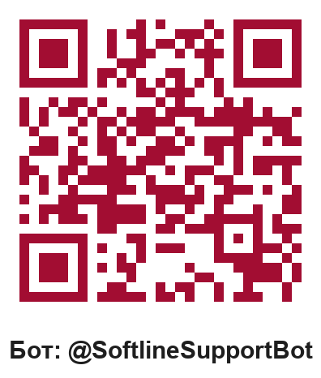

# Как проверить решение за 10 минут — памятка для жюри

**Ссылки:** сайт с ИИ-ассистентом — https://methodagent.ru · кабинет менеджера — https://methodagent.ru/manager · Telegram-бот менеджера — [@SoftlineSupportBot](https://t.me/SoftlineSupportBot) · материалы — https://methodagent.ru/materials/

| Сайт methodagent.ru | Telegram-бот @SoftlineSupportBot |
|:---:|:---:|
| {width=3.5cm} | {width=3.5cm} |

Стенд: https://methodagent.ru. Кабинет менеджера: https://methodagent.ru/manager. Два тестовых входа — администратор (`jury`) и менеджер (`jury.manager`); пароли переданы организаторам в форме сдачи и в открытых материалах не публикуются.

Откройте сайт и кабинет в двух окнах браузера рядом.

## 1. Обязательная часть: ответы на вопросы и подключение оператора

| Шаг | Что написать в чат на сайте | Что должно произойти |
|---|---|---|
| 1 | «Цены на сайте указаны с НДС?» | Ответ по базе знаний за несколько секунд |
| 2 | «Нужен MDaemon Standard на 10 пользователей, продление на год» | Сценарий «знаю продукт»: агент сверяет версии и редакции и предлагает ближайшие варианты из каталога |
| 3 | «Не знаю, что нужно, но хотим защитить почту и файлы на 50 сотрудников» | Сценарий «не знаю»: агент сначала задаёт уточняющие вопросы |
| 4 | «Коммерческая компания, Windows, своя почта, на год. А есть российский аналог?» | Варианты из каталога с ценами из фида и российские вендоры |
| 5 | «Оплатили, а ключ не пришёл», затем «не помогло» | Сначала инструкция из справки, потом передача менеджеру |
| 6 | Кнопка «Позвать оператора» | В кабинете («Живой чат», «Эскалации») обращение появится меньше чем за секунду |
| 7 | В кабинете: «Взять диалог» → ответить → «Вернуть агенту» | Ответ мгновенно появится у клиента; агент молчит, пока диалог ведёт менеджер |

## 2. Цикл «менеджер ответил → агент запомнил»

1. В чате на сайте спросите то, чего нет в базе знаний, например: «Можно ли получить счёт и закрывающие документы на английском языке?»
2. Если агент не передал обращение сам, нажмите «Позвать оператора».
3. В кабинете откройте «Эскалации», выберите это обращение, напишите ответ, оставьте галочку «Добавить ответ в базу знаний» и нажмите «Отправить клиенту».
4. На сайте нажмите «Новый диалог» и задайте тот же вопрос — агент ответит сам, словами менеджера.

## 3. Плюсы: скидки, КП и счёт, оплата

1. В кабинете откройте «Скидки» и добавьте акцию, например: вендор «Касперск», 7%, название «Демо-акция Kaspersky». Блок «Проверка: что увидит клиент» покажет товары со скидкой.
2. В чате спросите: «Сколько стоит Kaspersky Endpoint Security для бизнеса Стандартный на 50 ПК на 1 год?». Агент сам назовёт акцию и цену со скидкой.
3. Напишите «Берём, выставьте счёт» и заполните реквизиты (например, ИНН 7707083893). Счёт выдаётся сразу, скидка указана в строке документа.
4. Нажмите «Оплатить онлайн» (ЮKassa, демо-режим, деньги не списываются). Статус «Оплачено» появится в разделе «КП и счета».
5. Напишите «Можно с отсрочкой 30 дней?» — агент сразу передаст обращение менеджеру.

## 4. Команда: администратор и несколько менеджеров

Учётка `jury` — администратор.

1. Откройте «Команда»: создайте сотрудника (имя, лимит диалогов; логин можно не вводить) — появится блок с логином, паролем и одноразовой ссылкой-приглашением, всё копируется кнопкой.
2. Откройте ссылку в другом браузере или в окне инкогнито — это кабинет нового менеджера. В верхней строке выберите статус «В сети». Раздела «Команда» у менеджера нет.
3. На сайте нажмите «Позвать оператора» — обращение автоматически получит менеджер «в сети» с наименьшей нагрузкой. Он видит его в «Эскалации → Мои»; у администратора — исполнитель в списке.
4. В «Живом чате» менеджер: «Взять диалог» → «Позвать коллегу» → «Передать». Клиент видит имена и смену менеджера.
5. Поставьте менеджеру «Перерыв» — его невзятые обращения сразу уйдут коллеге в сети. «Команда» → журнал покажет все назначения и передачи.

## 5. Модель с открытыми весами

Откройте https://methodagent.ru/?model=open — тот же агент на Qwen3.6-35B-A3B (Apache 2.0, развёртывается в контуре Softline на одном GPU). В шапке чата — «открытые веса». Замер на 51 реальном обращении: маршрутизация 70,6% против 74,5% у GigaChat 2 Max, ошибок нет (описание решения, раздел 6.5).

## 6. Кабинет

- **Справка** — последний пункт меню. Там карта кабинета и все разделы по шагам со скриншотами.
- **Метрики** — блок «Регламент ответа»: раньше первого ответа человека ждали ~2 мин, медиана первого ответа агента — 3–4 с. Плюс «Закрыто агентом», CSAT и стоимость.
- **Telegram** — бот @SoftlineSupportBot. Каждый сотрудник подключает свой Telegram кнопкой «Подключить Telegram». Назначенные обращения приходят исполнителю, из очереди — всем, администраторам — копии. Ответ реплаем уходит клиенту с именем менеджера.

## Стенд — демо-прототип

На всех страницах плашка «Демо-прототип конкурса «ИИкузница»», стенд закрыт от поисковиков (noindex, robots.txt) — по условию организаторов.

## Материалы

https://methodagent.ru/materials/ — видео, описание, расчёт стоимости (Excel), презентация, руководства, отчёты RAGAS и регресса в браузере.
